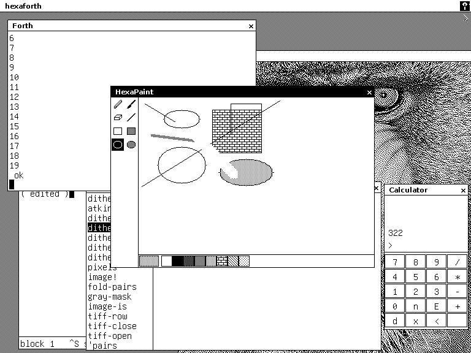

# The desktop

How to start the desktop, how to use it, and how to write a program for it. `forth/wm.fs` is the window manager and describes itself at its top, and `forth/desk.fs` opens the windows.

The target `screenshot` makes that picture, from a screen saved by the desktop's test.

## Starting it

`cmake --build build/cmake --target demo` boots the small AArch64 kernel on QEMU with a display, two disks, a keyboard and a pointer. The kernel runs the word `cold` when it starts, and `cold` runs `desktop`, which brings up QEMU's devices and runs `windows`, which opens the windows and runs the event loop. Whatever is typed at QEMU's serial console also goes to the window in front.

`cmake --build build/cmake --target demo-boot` starts the same machine with only the kernel's ROM in memory. The machine reads the system from its first disk and compiles the applications and the desktop from their source there, printing each file's label on the screen as it reads the file, and then runs the desktop.

A disk has at most 1,024 blocks, the capacity of an 8-inch floppy. The first disk is the one the machine starts from, or the one it is given when its image is already in memory, and it holds source, the names, HexaPaint's canvas, and the viewer's bitmap and gray. The second disk holds the pictures.

A machine with other devices brings them up itself and then runs `windows`. A machine with only a console uses the console's keys.

On the reference VM the display exists only in memory. The desktop's test drives the desktop there and saves a screen after each step (`build/64/desktop/`), and the tools `screen` and `png` make a picture of the display from the memory the VM writes out when it stops (the target `seen` builds them).

## Using it

| Action | What it does |
|---|---|
| click on a window | brings it to the front, where it gets the keys |
| press on a window's title, drag, and let go | moves the window by as far as the pointer moved |
| click on the `x` at the right of a window's title | closes the window |
| press on `hexaforth`, at the top left | drops down a menu of the windows, in bold if the window is open and plain if it is closed. Letting go on a line brings that window to the front, opening it if it was closed. Letting go on the title leaves the menu open, and the next click either picks a line or closes the menu |
| `^W` | brings the window at the back to the front |
| `^Q` | closes the window in front, or, once every window is closed, leaves the desktop for the serial prompt |

At the right of the menu bar are the disk lights: a floppy for each disk the machine has, the first disk's at the right and each next one to its left. The spindle of the disk in use turns while its blocks are being read or written, with an up arrow at its left after a read and a down arrow after a write. The arrow goes away once the disks have been idle for a few passes of the event loop.

The windows:

- **Forth** is a prompt. It runs as its own task, so its stack is kept from one line to the next and the desktop keeps going while a line runs. Text that has scrolled off is kept while there is room for it. PgUp and PgDn scroll through it by one line less than a window, and anything printed returns the view to the end. `[PGUP]` at the right of the first line means there is more above, and `[PGDN]` at the right of the last line means there is more below.
- **Editor** shows one block of the disk, 16 lines of 64 characters. Typing overwrites, the cursor keys move, PgUp and PgDn change block, `^S` writes the block, and `^L` writes it and loads it as Forth.
- **Mandrill** is a picture read from a TIFF and dithered. The viewer finds the TIFF by its label, `mandrill.tiff`, on whichever disk has it, which is the pictures' disk. A task dithers it a row at a time, and the picture appears down the window. The bitmap is written to the first disk a block at a time as its rows are made, so only a part of it is in memory at any time, and the window is repainted from the disk, reading only the blocks it needs. The Picture menu in the bar shows the picture in other ways. It can be kept as gray and painted straight from the gray to the window, through Bayer's mask or blue noise, finer or coarser, darker or lighter, or it can be dithered, which shows the bitmap on the disk again. The gray is on the disk too, and is made and read a block at a time.
- **Calculator** takes digits to make a number. Enter or the space bar pushes it, or duplicates the top when the entry is empty. `+ - * /` work on the top two, `n` negates, `x` swaps, `d` drops, and Backspace removes a digit. The buttons send the same keys.
- **Words** has the dictionary on the left and a decompiled definition on the right. Up and Down move through the dictionary, and Left and Right move by a page. Clicking a name shows it, clicking an underlined word follows it, and Backspace goes back. PgUp and PgDn scroll a long definition, with `[PGUP]` and `[PGDN]` as in the Forth window. With the pointer on a word, a box shows which instruction it is, by its fields.
- **HexaPaint** has its tools down the left (pencil and brush, eraser and line, rectangle and filled rectangle, oval and filled oval) and its patterns along the bottom. The drawing is saved on the disk.

The editor and the picture are only opened if the machine has a disk.

## Writing a program for it

A window is made by `window`:

    window ( x y w h title draw key click -- win )

`x y w h` are the window's position on the screen and its size, including the frame and title. `title` is a counted string starting on a cell boundary. The other three are the window's words, and `click` may be 0:

    draw   ( win -- )         paint what is inside the frame
    key    ( c win -- )       a key, while this window is in front
    click  ( x y win -- )     the button went down inside the frame

Each of the three must take `win` off the stack, even one that ignores it. The `x y` of a click are in the window's own coordinates, the same ones `draw` paints in, measured from the top left inside the frame. A window that ignores keys uses `ignore-key`.

In the drawing words, a port is a record of how drawing is done (where the origin is, what it is clipped to, the pattern, the font), which is a different thing from a port of the machine (`MODEL.md`). The screen has one, and each window has its own, which the window manager switches to before it runs `draw`.

### Drawing

The event loop runs `draw` to paint whatever part of the window is out of date and visible. Before running it, the window manager has made the inside of the frame white, set the clip to the area to be painted, and put the origin at the top left inside the frame, below the title. `draw` paints the whole window, in the window's own coordinates, and whatever is already up to date is clipped away. The inside is 2 pixels narrower than the window and 20 pixels shorter.

The drawing words are all in `display.fs` and `gfx.fs`. Where one takes a flag, true is white and false is black:

    fill-rect   ( flag x y w h -- )
    frame-rect  ( flag x y w h -- )     a one-pixel outline
    hline       ( flag x y n -- )
    pat-rect    ( x y w h -- )          in the current pattern: p-gray pattern !
    draw-char   ( c x y -- )
    draw-text   ( addr u x y -- )       text at a byte address
    draw-chars  ( a i u x y -- )        u characters starting at character i of the cells at a
    copy-bits   ( bitmap sx sy dx dy w h -- )
    plot        ( flag x y -- )

`fill-rect`, `frame-rect` and `hline` leave plain white or black as the pattern, so set the pattern again before the next `pat-rect`. The patterns are `p-white`, `p-black`, `p-gray`, `p-ltgray` and `p-dkgray`. `pat-rect` draws in the current mode: `copy-mode`, which a window's port starts in, `or-mode`, `xor-mode` or `bic-mode`.

`mono font !` and `sans font !` choose the font. A port starts with the system's plain font, which on the desktop is `mono`, so that is what `draw` gets. Both fonts are 16 pixels high. A `mono` character is 8 pixels wide, and in `sans` each character has its own width, so `chars-width ( a i u -- n )` and `text-width ( addr u -- n )` give the width of some text. The `x y` of text is its top left. In `draw`, `text-or` is true, so text adds its black to what is already there and leaves the rest alone, which is enough because the window has just been made white. `0 text-or !` makes text paint its white as well, which is what text over a pattern needs.

What `.` and `emit` print can be drawn by sending it to a buffer first: `sb-begin`, the printing words, `sb-end`, and then `sb-draw ( x y -- )`. The buffer holds 63 characters, and any more are dropped.

### Marking what has changed

A program draws only in `draw`. Code that changes something marks what is out of date, and the event loop repaints it:

    win-inval ( x y w h win -- )        a rectangle inside the frame

When a `key` or `click` word returns, its whole window is marked out of date, unless the word called `win-inval` itself. In that case only what it marked is repainted, and it may mark several rectangles, which add up. The calculator's keys change its numbers and leave its buttons alone, so `calc-key` marks just the numbers' rectangle, and the buttons on screen are left as they are.

### The pointer, the front window, and per-window data

- To follow the pointer while the button is down, `click` stores a word of `( x y win -- )` in `'track`. It is run every time the pointer moves, and once more when the button goes up, with `held` false. HexaPaint draws this way.
- To be told whenever the pointer moves, a program stores a word of `( x y win -- )` in `'moved`. The word is run with the pointer's position in the front window, in the coordinates a click uses, and with that window, which may belong to another program. The Words window shows its box this way.
- To draw over its window straight onto the screen, as the pointer is drawn, a program stores a word of `( on? -- )` in `'overlay`. The word is run with false before anything is painted, to remove what it drew, and with true afterwards, to draw it again. To change what the overlay shows, the program calls `overlays-off`, makes the change, and calls `overlays-on`. The program draws in its window with `win-port ( win -- )`, which clips to the visible part of the window, and returns to the screen's port with `screen-port @ port!`. `keep-bits ( bitmap x y w h -- )` saves the screen's cells under a rectangle and `put-bits` restores them. The Words window's box is drawn this way, so the window is painted once and the box moves over it.
- To be told when its window comes to the front, a program stores a word of `( win -- )` in the window's `win-front ( win -- a )`. To be told when another window comes in front of it, it stores one in `win-back ( win -- a )`. Each is 0 until a word is stored there. HexaPaint uses both: it reads its canvas from the disk when it comes to the front, and saves the canvas and frees its memory when it goes behind.
- `win-data ( win -- a )` is a cell of the window's record for the program's own use. The picture viewer keeps its record there.

### Long-running work

The event loop runs each of a window's words to completion, so a slow one holds up the whole desktop. Give such work to a task (`spawn`), which does a piece of it and then calls `pause`. `view.fs` reads and dithers its picture this way.

### Memory

`halloc ( u -- a )` allocates u bytes, in whole cells, and returns the address of a cell. `hgive ( a cells -- )` frees it. `hreuse` is a `halloc` that reuses freed memory when enough of it is free.

### An example

`doc/hello.fs` is a window that counts the keys it gets:

    create t-hello  34 parse Hello" s,
    variable presses

    : hello-draw ( win -- )
       drop  false 8 8 120 40 frame-rect  presses @ '0' + 16 20 draw-char ;

    : hello-key ( c win -- )
       swap 'q' = if drop  presses @ .  nwin @ .  8000 execute then
       >r  1 presses +!  0 0 136 56 r> win-inval ;

    display-init  no-windows
    40 60 200 120 t-hello ' hello-draw ' hello-key 0 window drop
    event-loop
    abcq

`34 parse` takes the text up to the next `"`, whose character code is 34, and `s,` compiles it with its length in front, which makes the title. Numbers typed at the prompt are decimal.

It is the only window, so it sets the screen up itself in place of `windows`: `display-init` makes the screen's port and switches to it, and `no-windows` starts the list of windows empty. `event-loop` marks the whole screen out of date, and then on each pass takes a key if one is waiting and repaints what is out of date. The reference VM always reports a key waiting, so there the first key is taken before the first paint.

What is typed after `event-loop` goes to the window as keys: `a`, `b` and `c` are counted, and `q` ends it. The nucleus leaves halting to the all-zero instruction (`MODEL.md`), so the program jumps to one: `8000 execute` goes to a spot on page 1 that is past the end of its code on every machine. The reference VM keeps running when its input ends, so a file typed at it has to halt it.

`cmake --build build/cmake --target hello` types that file at the reference VM, prints the VM's output (which ends with `3 1`), and writes a picture of the display to `build/hello/hello.png`. To do the same by hand with your own file, once `hello` or `seen` has built the tools, with `/tmp/mine` standing for a directory of your own:

    build/cmake/hexaforth build/64/nuc.hex build/64/disk.img /tmp/mine/memory.out < /tmp/mine/mine.fs
    build/cmake/screen build/64/nuc.hex /tmp/mine/memory.out /tmp/mine/mine.pbm
    build/cmake/png /tmp/mine/mine.pbm /tmp/mine/mine.png

The VM's arguments are the image, a disk, and the file to write its memory to when it stops. `screen` takes the image too, which tells it which machine the memory belongs to. The VM opens the disk for writing, so give a program that writes blocks a copy of `disk.img`.

### A machine's devices

The desktop needs three things from a machine, each a word that a driver stores in a cell. The kernel stores the two disk words when the machine starts, from the driver of the disk controller it finds (`MODEL.md`, Other devices). The driver of the keyboard and the pointer stores `'poll`. `desktop`, in `desk.fs`, does that for QEMU's devices, and a machine with other devices does the same and then runs `windows`.

    'blk-read   ( buf blk# -- )    read block blk#, 1,024 bytes, into the cell buf
    'blk-write  ( buf blk# -- )    write it from there
    'poll       ( -- )             ask the keyboard and the pointer for new events

With no disk the two block words stay 0, and the editor and the picture stay closed. Where `'poll` is 0, the console's keys are used.

`'poll` passes each event it gets to `on-event ( type code value -- )`, in the form Linux input devices use:

| Type | What it reports |
|---|---|
| 1 | a key or a button. `code` is the Linux key code, and `value` is 1 for down and 0 for up. Code `0x110` is the pointer's button. The two shift keys and the two control keys are tracked, and any other key going down is turned into a character by `keymap.fs`, whose rows are those codes |
| 3 | the pointer's position, one axis at a time: `code` 0 is horizontal and anything else is vertical, and `value` is in 32,768ths of the screen |
| 0 | that the device has reported everything it has for now. A word that is following the pointer is called then |

### Adding a program to the system

- The program is a file in `forth/`, and `apps.fs` includes it. The line that includes it also names the code page the file goes on: `small-page` for a 64K-cell machine and `big-page` for a larger one. The target `examine-16` shows how much room each page has left.
- A word that `desk.fs` names needs a header (`header name : name`). Every other word belongs to its file only, and where the machine compiles the file from its disk, the word's name leaves the dictionary when the file has been read.
- `windows`, in `desk.fs`, makes the window. Where it goes is a line in each of the two tables there: `big-desk` for a 768 by 576 screen and `small-desk` for a smaller one.
- A variable must be within the 4,096 cells one instruction can reach. A table or a buffer goes between `bulk` and `unbulk`.
- `check` runs the desktop's test on every machine. To have a window tested, give it a line in the table in `test/deskcheck.c`.

`calc.fs` is the shortest program that has keys, a click and its own rectangle marked out of date. `view.fs` has a task and `win-data`. `paint.fs` has `'track`, `win-front`, `win-back` and the disk.
