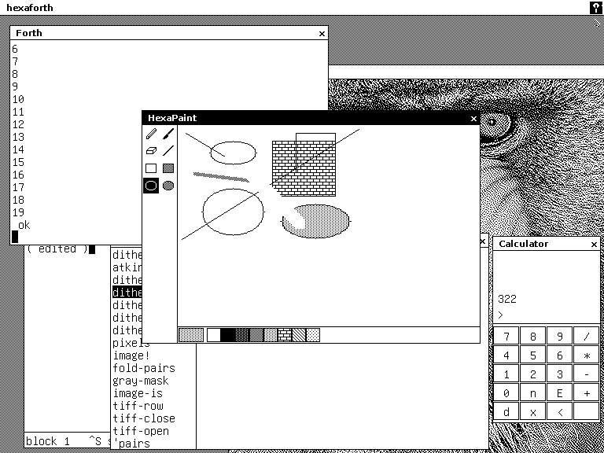

# hexaforth

A stack machine whose instructions are fields that drive it directly, a
Forth operating system with windows, a pointer and menus that runs on it,
and the Verilog to build it from.

The CPU with cells of 16 bits is 7,458 gates, which is fewer than a Z80
counted the same way, with the memory of its two stacks left out.  Drawing, it takes 1.06 to 1.36 clocks an instruction,
so at 1.2 MHz it runs 0.88 to 1.13 million instructions a second.

## What it is here to show

- How much a machine of 7,458 gates does at 1.2 MHz: fewer gates than the
  Z80 of 1976, at a clock the microcomputers of 1979 ran at
- What could have been: a desktop on a machine of that size and speed
- A Forth operating system with a desktop.  Overlapping windows, regions, a
  menu, a pointer, proportional text, and programs: the Forth prompt in a
  window, a block editor, a viewer that reads a TIFF and dithers it, a
  calculator, a paint program, a decompiler
- The instruction set.  An instruction is a control word: where the ALU's
  input comes from, the operation, where the result goes, how each stack
  moves
- How little code it takes.  The kernel is 3,332 bytes, in a ROM of 4,096.
  The paint program is 2,270.  The whole machine, written in AArch64
  assembler, is 880

It is meant to be built, as TTL, on an FPGA, or through TinyTapeout.

## The machine

Two stacks, a memory of cells, and ports for devices.  A cell is 16, 32 or 64
bits and an instruction is always 16.  `MODEL.md` says exactly what the
machine is, and `UNDERSTANDING.md` why it is so.

An instruction of the ALU is three bits that say it is one and six fields,
and every setting of the fields is an instruction the machine carries out:

    15   14 13   12    11 10    9 8      7 6 5 4     3 2      1 0
     0    1  1   ret   input    output   operation   d-stack  r-stack

- **input**: the top of the stack, the cell under it, the cell of memory the
  top points at, or the top of the return stack
- **operation**: one of sixteen.  Pass the input through, two that also
  write the cell under the top, add, and, or, xor, multiply, complement,
  three comparisons, two shifts, fetch, and read a port
- **output**: the top of the stack, the top of the return stack, the cell of
  memory the top points at, or a port
- **the stacks**: each moves up one, down one or two, or stays
- **ret**: return as well

Fetching is a choice of input and storing is a choice of output, and an
operation can be done on memory where it lies.  `+!` is one instruction:
memory in, add, memory out.  So is OR-ing a mask into a cell of the display,
which is what drawing a glyph is made of.  Subtracting is a complement, an
add of one and an add, three instructions, and what is complemented can come
from any of the four inputs.

The other instructions are a jump, a conditional jump, a call, and a literal
of twelve bits that is pushed or added to the top of the stack, or that
fetches or stores one of 4,096 variables.

A word of Forth is a name for one of these instructions or for a run of
them.  Leaving out those that read or write a port, the fields make 5,344
instructions that do different things, many settings doing the same as
another.  Fifty-six of those have a name, and the system uses 308: the rest
of those it uses are made by the compiler, which joins a run into one
instruction wherever one does the same work, and finds that out by asking
the machine.  (The target `profile` counts them, of the image with cells of
64 bits.)  `MODEL.md` says what every field does.

## What it comes to

These are what the tree's own targets print, and each is named so that it can
be asked again.  They are of the tree as it was when this was written.

**The CPU** (`gates`).  A gate is a NAND, a NOT or a flip-flop as Yosys
counts them, with memories left out.  For hexaforth what is left out is its
two stacks, 256 cells each; the Z80 has no memory to leave out, and its
registers are counted.  The Z80 and the 68000 are other people's Verilog
put through the same count.

| | gates |
|---|---|
| hexaforth, cells of 16 bits | 7,458 |
| the same without its multiplier | 6,449 |
| a Z80 (tv80) | 9,443 |
| a 68000 (fx68k) | 22,948 |
| hexaforth, cells of 32 bits | 15,650 |
| hexaforth, cells of 64 bits | 39,964 |

**Its speed** (`bench-draw`).  On the Verilog CPU with cells of 16 bits and
memory that answers in one cycle, an instruction takes 1.36 clocks drawing
text, 1.16 scrolling and 1.06 filling.  An instruction is one clock, and one
more for a read of memory or a shift, and two more for a multiply.

**The system** (`examine-16`), on the machine with cells of 16 bits: 65,536
of them, which is 128KB, and a display of 512 by 342.

| | words | bytes of code |
|---|---|---|
| The kernel, in a ROM of 4,096 bytes | 258 | 3,332 |
| All drawing: fills, copying, text | 127 | 5,068 |
| Regions | 30 | 1,390 |
| The window manager | 61 | 2,556 |
| The TIFF reader and the dither | 89 | 2,762 |
| The Forth window | 14 | 632 |
| The block editor | 5 | 480 |
| The picture's viewer | 21 | 556 |
| The calculator | 9 | 668 |
| The paint program | 39 | 2,270 |
| The decompiler and the Words window | 86 | 4,114 |
| The compiler's peephole, for what is typed | 23 | 1,200 |
| Everything | 814 | 26,140 |

The dictionary is 373 names in 3,200 bytes, five bits to a character.

**The machine on another processor** (`size`).  `baremetal/hexaforth.S` is
the whole machine in AArch64 assembler, with a console.  It is 880 bytes:

| | bytes |
|---|---|
| Starting | 60 |
| Fetching an instruction and telling which kind it is | 24 |
| Jumps, conditional jumps and calls | 64 |
| Literals and variables | 80 |
| The ALU: choosing its input | 52 |
| The sixteen operations, two instructions each | 128 |
| The stacks moved, and the result sent where it goes | 116 |
| The ports: the console, the stacks' depths, the host's memory | 344 |
| Halting | 12 |

What carries out every instruction is 464 bytes, which is 116 instructions
of AArch64.

## What is in the kernel

The kernel is the first 4KB of page 0: the part that is in ROM, and all that
is needed to type Forth at the machine and have it compiled.  It has 258
words, and these 202 of them have names that can be typed.

- **The stacks**: `dup drop swap over nip tuck rot -rot ?dup 2dup 2drop 2swap
  2over 2rot 3dup depth adepth`, and `>r r> r@ rdrop @r swap>r swapr> i j
  unloop`
- **Arithmetic**: `+ - * 1+ 1- 2* 2/ negate abs min max um* um/mod u/mod`
- **Bits**: `and or xor invert lshift rshift`
- **Comparison**: `= <> < > u< u> 0= 0<> 0< 0> true false`
- **Two cells as one number**: `d+ d- dnegate dabs s>d d>s d= d< du< d0= d0<
  d2* d2/ 2@ 2!`
- **Memory**: `@ ! +! or! and! xor! *! not! dup@ over@ c@ c! uw@ w! field@
  field! >c c> hi32 lo32 hi16 lo16 count cell+ cells aligned align fill cmove
  cmove> cells-move cells-fill /string bounds i@ i!`
- **The console and the ports**: `key key? emit uart-emit 'emit cr space bl
  type . .x .x2 hex1 accept io@ io!`
- **The interpreter**: `source source-id sourceid >in parse parse-name
  isspace? isnotspace? isnotdelim >number base decimal hex state interpret1
  refill evaluate quit execute \ (`
- **The compiler**: `: ; :noname ] [ immediate create does> variable constant
  , c, w, s, compile, literal 2literal postpone recurse exit ' ['] inline:
  join-rules`, and `if else then ahead begin again until while repeat do ?do
  loop +loop leave`
- **The dictionary**: `forth labels sfind name> words here allot dp cp`
- **Errors**: `catch throw -throw`
- **Tasks**: `up sbase spawn pause`
- **Blocks**: `blk`

## Seeing it

It needs CMake and either Homebrew or apt.  Configuring installs the rest:
it runs `brew install`, or `apt-get install` as root, for what is missing
of the twenty programs and libraries it needs, QEMU, Verilator, Yosys and
LLVM among them.
`-DINSTALL_NEEDED=OFF` has it only look and say what is missing, and the top
of `CMakeLists.txt` lists them all.

    cmake -S . -B build/cmake
    cmake --build build/cmake --target demo      # the desktop, on QEMU
    cmake --build build/cmake --target check     # every test
    cmake --build build/cmake --target bench     # the benchmarks, on the Verilog CPU
    cmake --build build/cmake --target gates     # the gates

`cmake -DMIPS=1 build/cmake` before `demo` holds the machine to a million
instructions a second.

`demo` wants a QEMU that has a display.  Without one:

    cmake --build build/cmake --target hello        # a window typed at the reference VM, and a picture of it
    cmake --build build/cmake --target screenshot   # the picture above, made again

`DESKTOP.md` says how the desktop is worked and how a program for it is
written.

## What there is

The machine is made three times, and the second and third are tested
against the first:

- `vm.c`, the reference: a virtual machine in C
- `baremetal/`, the machine twice in AArch64 assembler, for QEMU, where the
  desktop is shown: the small one above, and one that is quicker and decodes
  by table.  The tree calls these kernels too (`KERNEL`, `kernel_size`,
  `build/kernel/`), being what QEMU boots.  Elsewhere the kernel is the
  first 4KB of the Forth
- `rtl/`, the CPU in Verilog, which runs the system in simulation, and which
  the target `synth` places and routes for an FPGA

The system is Forth (`forth/`), built by a cross-compiler that is itself
Forth.  The image it builds is called the nucleus, after `nuc.fs`: the
kernel, which is the part in ROM, and the system that file includes.  The
tests, the tools and the benchmarks are C.

## Where it stands

None of it has been built as hardware yet.  What there is to build from is
`rtl/soc.v`: the CPU and its memory, with a clock, a reset, a console as
bytes sent and bytes taken, each with a handshake, and a wire that says the
machine has halted.  Its cell, its memory and how long its memory takes to
answer are parameters, and with `HF_KROM` the kernel is a ROM.  The target
`synth` places and routes it for an ECP5 and says what clock it would meet.

What a built machine needs that is yet to be made:

- the display scanned out as video: the Verilog has the bitmap in its memory
  and nothing that shows it
- a keyboard, a pointer and a disk, and a driver for each: the system's are
  for QEMU's.  `DESKTOP.md` says what the system asks of each
- a board

## Where it came from

It began in 2020 as an experiment: whether a virtual machine whose
instructions are unencoded, in the manner of the Novix NC4016 and the
[J1](https://excamera.com/files/j1.pdf), would be faster than one that
decodes bytecode.  The instruction came from the J1's, as swapforth's J1b has
it, with its one field of fixed routes for where a result goes replaced by
two fields, one choosing the input and one the output.

## Reading on

- `MODEL.md`: what the machine is, which all three implementations keep to
- `UNDERSTANDING.md`: why it is as it is
- `DESKTOP.md`: how the desktop is worked, and how a program for it is
  written
- `CLAUDE.md`: how to build, test and measure, where everything is, and the
  rules of working here
- the commits: each says what was changed, why, and what it cost or saved
